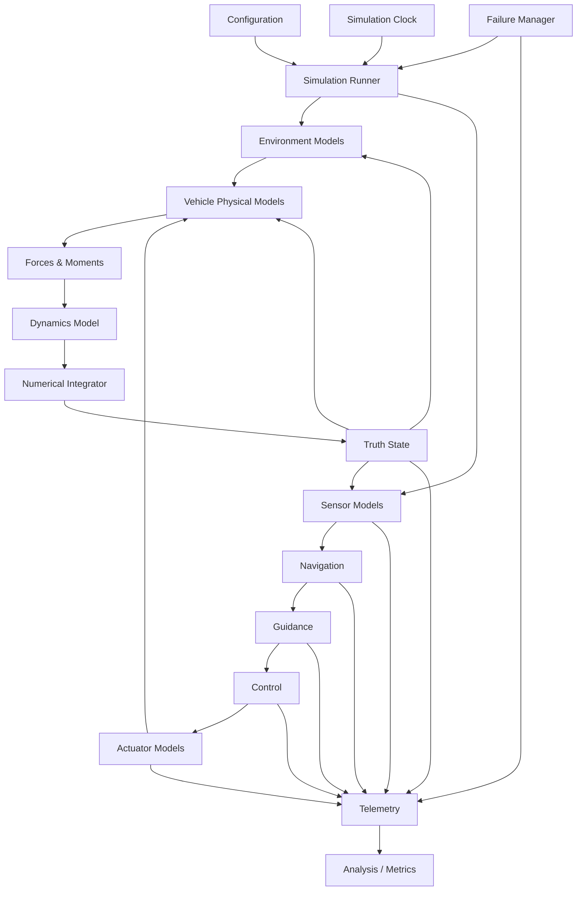

# AeroForge System Architecture

## 1. Purpose

This document defines the core software architecture for AeroForge, covering the Phase 0.9 through 0.21 design decisions.

The architecture is intended to support:

- deterministic simulation
- interchangeable numerical integrators
- progressive physics fidelity
- multiple vehicle types
- sensor and actuator modeling
- guidance, navigation, and control
- failure injection
- testing and validation
- future Monte Carlo and real-time execution

---

## 2. Core Rigid-Body State

The authoritative 6DOF rigid-body state is conceptually:

```text
RigidBodyState
├── position_N          (3)
├── velocity_N          (3)
├── q_NB                (4)
└── angularVelocity_B   (3)
```

This produces a 13-component representation.

Mass is **not** treated as an intrinsic part of the rigid-body kinematic state.

Vehicle-specific internal state may additionally include:

- propellant mass
- actuator states
- controller states
- estimator states
- failure states

These belong to a higher-level vehicle/simulation state rather than the reusable `RigidBodyState`.

---

## 3. Simulation Time Model

The physics simulation uses a dedicated simulation clock.

Conceptual state:

```text
SimulationClock
├── startTimeSeconds
├── stepIndex
├── timeStepSeconds
└── endTimeSeconds
```

For fixed-step simulation:

\[
t = t_0 + n\Delta t
\]

where `n` is the integer step index.

Wall-clock time is never authoritative for physics.

Real-time mode, when added later, only paces execution to wall time.

---

## 4. Simulation Loop

The conceptual fixed-step loop is:

```text
State at time t
    ↓
Apply scheduled failure events
    ↓
Evaluate environment
    ↓
Sample due sensors
    ↓
Update navigation if due
    ↓
Update guidance if due
    ↓
Update controller if due
    ↓
Update actuator dynamics
    ↓
Evaluate forces / moments through dynamics model
    ↓
Numerically integrate t -> t + dt
    ↓
Enforce numerical invariants
    ↓
Advance simulation clock
    ↓
Record telemetry
```

Discrete subsystems may update at different rates.

Between their scheduled updates, their outputs are held according to the model contract.

Continuous dynamics may be evaluated multiple times inside a single timestep by higher-order numerical integrators.

---

## 5. Numerical Integration Architecture

The dynamics model and integrator must remain separate.

Conceptually:

\[
\dot{x} = f(t, x, u)
\]

The integrator owns the numerical method.

The dynamics model owns the state derivative.

Planned integrators include:

```text
Integrator
├── EulerIntegrator
├── RK2Integrator
├── RK4Integrator
└── RK45Integrator       (later)
```

The dynamics code must not contain assumptions such as:

```text
"the current integrator is RK4"
```

---

## 6. Major Modules

The long-term logical modules are:

```text
core
math
environment
dynamics
vehicle
sensors
actuators
gnc
failures
logging
analysis
```

### `math`

Owns mathematical primitives and transformations.

Examples:

- vectors
- matrices
- quaternions
- coordinate transformations

### `core`

Owns simulation-wide infrastructure and shared contracts.

Examples:

- simulation clock
- simulation runner
- common state/data contracts
- scheduling abstractions
- run metadata

### `environment`

Owns replaceable environmental models.

Examples:

- gravity
- atmosphere
- wind
- ground model

### `dynamics`

Owns equations of motion and state-derivative evaluation.

It consumes state, mass properties, applied loads, and environment information but should not know how a controller chose an actuator command.

### `vehicle`

Owns vehicle-specific composition and physical models.

Examples:

- mass properties
- aerodynamics
- propulsion
- geometry/reference data
- rocket reference vehicle

### `sensors`

Owns truth-to-measurement models.

### `actuators`

Owns command-to-physical-actuator-state models.

### `gnc`

Owns navigation, guidance, and control algorithms.

### `failures`

Owns failure definitions, scheduling, and injection.

### `logging`

Owns telemetry and diagnostic output.

### `analysis`

Owns run-level metrics and later Monte Carlo aggregation.

---

## 7. Dependency Direction

The intended high-level dependency direction is:

```text
                ┌──────────── analysis
                │
logging <-------┤
                │
core -----------┼-------> simulation orchestration
 │              │
 ├── math       │
 ├── environment
 ├── dynamics
 ├── vehicle
 ├── sensors
 ├── actuators
 ├── gnc
 └── failures
```

More important than the exact diagram are these rules:

1. `math` depends on almost nothing.
2. Physics models do not depend on visualization.
3. Environment models do not depend on a specific vehicle.
4. Dynamics does not depend on a specific controller.
5. Sensors observe truth state; they do not modify it.
6. GNC consumes measurements/estimates and produces commands.
7. Actuators convert commands into physical states.
8. Telemetry observes; it does not control simulation behavior.
9. Failure injection uses explicit component interfaces rather than global mutation.
10. Circular dependencies between modules are prohibited.

---

## 8. Vehicle Architecture

AeroForge should treat a vehicle as a composition of physical models rather than one monolithic class.

Conceptually:

```text
VehicleModel
├── MassPropertiesModel
├── AerodynamicsModel
├── PropulsionModel
├── Geometry / Reference Data
├── Sensor Set
└── Actuator Set
```

The simulation engine must not hard-code rocket behavior.

The initial research rocket is one concrete composition of the generic simulation framework.

---

## 9. Mass Properties

Mass properties are treated coherently:

```text
MassProperties
├── mass
├── centerOfMass_B
└── inertiaTensor_B
```

The initial models may return constants.

Later models may vary these values with propellant state.

---

## 10. Force and Moment Architecture

AeroForge separates force/moment generation from rigid-body dynamics.

Planned load sources include:

- gravity
- aerodynamics
- propulsion
- actuator-generated loads
- future disturbances

Baseline frame contracts:

- gravity acceleration: navigation frame
- aerodynamic force/moment: body frame
- propulsion force/moment: body frame
- actuator-generated force/moment: body frame
- moments are about the current center of mass unless documented otherwise

The dynamics layer transforms quantities as required by the equations of motion.

---

## 11. Environment Interfaces

Environment models should be queryable through stable contracts.

Conceptually:

```text
Environment
├── GravityModel
├── AtmosphereModel
├── WindModel
└── GroundModel
```

A vehicle model should not need to know whether gravity is constant or altitude-dependent.

Similarly, aerodynamics should consume atmospheric properties without depending on one particular atmosphere implementation.

---

## 12. Sensor Architecture

Sensors convert truth-state quantities into measurements.

Conceptual flow:

```text
Truth State
    ↓
SensorModel
    ↓
Timestamped Measurement
```

Each sensor may eventually define:

- update rate
- noise
- bias
- drift
- latency
- saturation
- dropout/failure behavior

Sensor outputs must carry a simulation timestamp.

GNC should consume measurements or estimated state rather than directly reading truth state in the flagship mission.

---

## 13. Actuator Architecture

Actuators convert control commands into physical actuator state.

```text
Controller Command
       ↓
Actuator Model
       ↓
Physical Actuator State
       ↓
Force / Moment Generation
```

Actuator models may include:

- position limits
- rate limits
- latency
- deadband
- saturation
- degradation
- failure

Controllers do not directly rotate or translate the vehicle.

---

## 14. GNC Architecture

Guidance, navigation, and control are separate responsibilities.

### Navigation

Answers:

> Where am I and how am I moving?

Produces estimated state.

### Guidance

Answers:

> Where should I go?

Produces desired trajectory/state/attitude.

### Control

Answers:

> What actuator command should I issue?

Produces commands for actuator models.

Conceptual flow:

```text
Sensors
  ↓
Navigation
  ↓ estimated state
Guidance
  ↓ desired state
Control
  ↓ commands
Actuators
```

---

## 15. Failure-Injection Architecture

Failures are explicit simulation events.

Conceptually:

```text
FailureEvent
├── startTime
├── optionalDuration
├── componentId
├── failureType
└── parameters
```

Possible examples:

- GPS dropout
- gyro bias shift
- actuator stuck position
- actuator degradation
- thrust reduction

Failure handling must be deterministic for a fixed configuration and random seed.

Failure code must not depend on hidden global mutation.

---

## 16. Truth State vs Estimated State

AeroForge maintains a strict conceptual boundary:

```text
Truth State
    ↓
Sensors
    ↓
Measurements
    ↓
Navigation
    ↓
Estimated State
```

Truth state is available to validation and telemetry.

Estimated state is what GNC should use in realistic closed-loop scenarios.

---

## 17. Continuous vs Discrete Components

AeroForge will contain both continuous-time and discrete-time models.

### Continuous or integrator-evaluated

Examples:

- rigid-body derivatives
- gravity
- aerodynamics
- propulsion force as a function of time/state

### Discrete scheduled components

Examples:

- GPS updates
- controller updates
- guidance updates
- failure events
- telemetry sampling

The architecture must allow these different update rates without tying every subsystem to the physics timestep.

---

## 18. Architecture Diagram



---

## 19. Architecture Rules

- The simulator core remains independent of visualization.
- Numerical integration remains interchangeable.
- Vehicle-specific code remains outside generic core logic.
- Frames and units are explicit at boundaries.
- Continuous dynamics are not coupled to wall-clock execution.
- Random behavior is explicitly seeded.
- Components are testable independently.
- Physics models expose assumptions and validity.
- No subsystem silently modifies another subsystem's state.
- Composition is preferred over monolithic vehicle logic.

---

## 20. Phase 0.9–0.21 Acceptance Criteria

- [x] Rigid-body state representation defined.
- [x] Simulation time model defined.
- [x] Simulation-loop ordering defined.
- [x] Integrator abstraction defined.
- [x] Major modules identified.
- [x] Dependency rules established.
- [x] Vehicle composition defined.
- [x] Mass-property ownership defined.
- [x] Force/moment contracts defined.
- [x] Environment interfaces defined.
- [x] Sensor architecture defined.
- [x] Actuator architecture defined.
- [x] GNC responsibilities separated.
- [x] Failure-injection concept defined.
- [x] Truth/measurement/estimate separation established.
- [x] Multi-rate subsystem requirement established.
- [x] Architecture diagram created.
