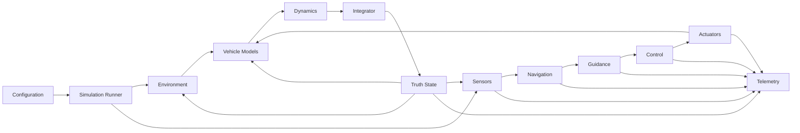

# AeroForge System Design

## 1. Purpose

This document is the top-level Phase 0 system-design index for AeroForge.

Detailed decisions are maintained in focused documents so they can evolve independently without turning one file into an unmanageable specification.

---

## 2. Project Objective

AeroForge is a modern C++ aerospace simulation, guidance, navigation, and control platform.

Its first reference vehicle is a single-stage guided research rocket.

The platform is designed around:

- 6DOF rigid-body dynamics
- progressive model fidelity
- deterministic execution
- numerical verification
- sensor and actuator modeling
- GNC
- failure injection
- Monte Carlo analysis
- performance measurement
- future visualization and hardware-in-the-loop integration

---

## 3. Authoritative Phase 0 Documents

### Coding

- [Coding Standards](CODING_STANDARDS.md)

### Mission and Scope

- [Initial Simulation Mission](INITIAL_SIMULATION_MISSION.md)
- [Simulation Scope and Assumptions](SIMULATION_SCOPE_AND_ASSUMPTIONS.md)

### Physical Conventions

- [Coordinate Systems](COORDINATE_SYSTEMS.md)
- [Units and Conventions](UNITS_AND_CONVENTIONS.md)

### Architecture

- [System Architecture](SYSTEM_ARCHITECTURE.md)
- [Repository Structure](REPOSITORY_STRUCTURE.md)

### Reproducibility and Data

- [Configuration and Reproducibility](CONFIGURATION_AND_REPRODUCIBILITY.md)
- [Telemetry and Numerical Safety](TELEMETRY_AND_NUMERICAL_SAFETY.md)

### Verification

- [Verification and Validation Plan](VERIFICATION_AND_VALIDATION_PLAN.md)
- [Phase 1 Acceptance Criteria](PHASE_1_ACCEPTANCE_CRITERIA.md)

### Phase Gate

- [Phase 0 Completion Checklist](PHASE_0_COMPLETION_CHECKLIST.md)

---

## 4. Core Design Decisions

### Language

```text
C++20
```

### Build

```text
CMake
```

### Initial Operating Domain

```text
local atmospheric flight
```

### Earth

```text
flat/local, non-rotating initially
```

### Frames

```text
navigation: NED
body: X forward, Y right, Z down
right-handed
```

### Units

```text
SI internally
radians internally
double precision by default
```

### Orientation

```text
unit quaternion q_NB
body -> navigation
```

### Time

```text
simulation clock independent of wall clock
fixed-step initially
```

### Architecture

```text
replaceable physics models
separate integrators
separate GNC responsibilities
truth state distinct from estimated state
```

### Determinism

```text
explicit configuration + explicit seed + reproducible run metadata
```

### Validation

```text
simple verified models before higher fidelity
```

---

## 5. High-Level Data Flow



---

## 6. Initial Model-Fidelity Ladder

```text
Level 0: mathematical validation
Level 1: basic atmosphere + drag
Level 2: powered 3DOF vehicle
Level 3: 6DOF rigid body
Level 4: full open-loop rocket
Level 5: sensors + GNC + actuators
Level 6: uncertainty + failures + Monte Carlo
```

No higher level invalidates the need to preserve lower-level verification cases.

---

## 7. Major Known Limitations

The initial design does not attempt:

- flexible-body dynamics
- CFD
- detailed combustion
- weather forecasting
- full structural mechanics
- general collision physics
- Earth rotation
- Earth curvature
- orbital mechanics

These are explicit scope decisions, not accidental omissions.

---

## 8. Phase 0 Exit Condition

Phase 0 is complete when:

1. the documentation set is internally consistent
2. CMake builds the current project cleanly
3. coordinate and unit conventions are unambiguous
4. architecture avoids obvious circular dependencies
5. Phase 1 math requirements are defined
6. Phase 0 review checklist passes
7. the baseline is committed and tagged

Recommended tag:

```text
v0.1.0-phase0
```
